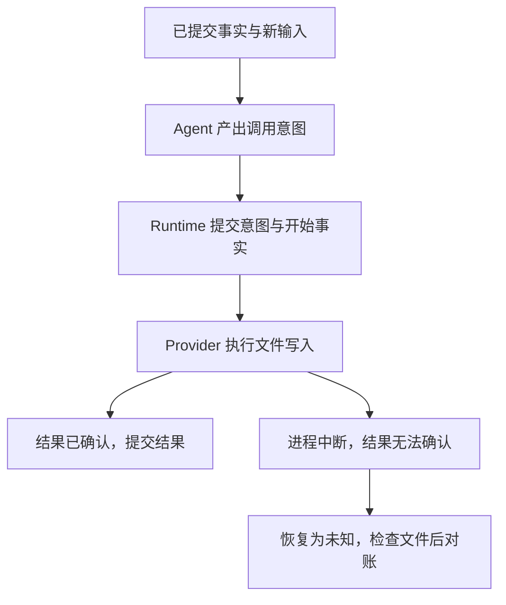

# Archer Harness

**Agent 写入了文件，进程却在记下结果前退出。重启后，要再写一次吗？** Archer 会从日志恢复为「结果未知」，保留这次调用供核对，避免重复写入。

Archer Harness 是一个用 TypeScript 编写的实验性 Agent 执行框架，提供桌面应用和 HTTP/SSE 服务。它把模型请求、能力调用和恢复依据放在可核对的执行链上。

## Archer 如何执行一次文件写入

Agent 根据已提交事实、新输入和显式上下文作出决策。相同的输入得到相同的决策。Runtime 先记录写入意图和开始事实，再调用固定的 Provider 能力。执行结果提交后，桌面可据此展示调用活动和文件变更回执。



恢复时，已经提交的结果直接从日志读取。只有开始事实的写入进入「结果未知」，等待检查磁盘后对账。测试模拟了结果尚未追加到日志，以及结果已追加但确认丢失两种情况，并验证重启时不会重写文件。 [文件写入恢复测试](tests/archer/fs-write-recovery.test.ts#L238) · [执行与恢复](docs/architecture/runtime-design.md)

## 最小内核的实际代码


下面是 Kernel 的完整 `run` 函数。

```ts
export async function run<E, T, R>(
  program: Generator<E, T, R>,
  handler: (effect: E) => R | PromiseLike<R>,
): Promise<T> {
  let step = program.next();
  while (!step.done) {
    let result: R;
    try {
      result = await handler(step.value);
    } catch (error: unknown) {
      step = program.throw(error);
      continue;
    }
    step = program.next(result);
  }
  return step.value;
}
```

这里的 `try` 只包住 Handler 调用。Handler 失败时，Kernel 用 `program.throw(error)` 把异常交回 Generator，由流程决定是否捕获。流程在 `program.next(result)` 中抛出的异常直接向调用方传播。 [Kernel 源码](packages/kernel/src/run.ts) · [异常与清理测试](tests/kernel/run.test.ts)

Runtime 通过 `runCommands` 接入驱动，由执行管线处理授权和提交。Generator 在当前进程内暂停。重启时，Runtime 从 Journal 回放已提交事实，再重建待执行工作。 [Runtime 调用点](packages/runtime/src/archer/session-runtime.ts#L990)

## 当前能力

- 持续会话、多轮输入、后续任务队列与运行中引导。
- 文件读取、编辑与 Shell 命令确认。
- 可配置的模型推理、本地技能包与独立持久记忆 Provider。
- 桌面中的对话、调用活动、请求上下文和工具确认的文件变更审阅。
- JSONL 事实日志、未知操作对账与会话恢复。

## 快速开始

需要 Node.js ≥22.19.0，以及根 `package.json` 指定的 pnpm 版本。当前从源码运行，不提供桌面安装包或已发布的 npm SDK。

```bash
pnpm install --frozen-lockfile
pnpm build
pnpm dev:desktop
```

首次启动默认使用确定性的 Mock 推理，用于验证界面与执行链路，不会调用真实模型。要完成实际任务，请先按[首次运行与模型配置](docs/guides/getting-started.md)配置模型服务，再选择一个存在的绝对工作目录。

独立服务：

```bash
pnpm dev:server
```

默认监听 `127.0.0.1:3000`。模型凭据、会话数据和个人技能不应提交到仓库。Shell 使用宿主权限，不是沙箱；桌面默认逐次询问命令。

## 核心概念

| 概念 | 职责 |
| --- | --- |
| Camp | 管理 Provider 声明、能力引用、契约校验和资源生命周期 |
| Contract | 分离可序列化能力元数据与进程内实现接口 |
| Effect | 显式表达 Agent 的执行意图 |
| Agent | 从已提交事实折叠状态，执行纯决策 |
| Runtime | 串行提交事实并执行能力，处理取消与恢复 |
| Kernel | 只交接 Generator 的 yield / next / throw |

## 设计取舍

### 同一会话串行提交，Prompt 编译在锁外完成

同一 Agent 的输入接收、幂等检查、队列消费、决策和提交按顺序进行。编译 Prompt 前，Runtime 在锁内捕获会话版本，再释放锁。编译完成后重新加锁检查版本，取消、停止或版本变化会使旧结果失效。这样，准备 Prompt 期间仍能接收输入和取消请求，同时避免旧 Prompt 推进已经变化的会话。 [Runtime 串行执行与恢复](docs/architecture/runtime-design.md)

### 工具名用于模型调用，能力引用用于执行与恢复

模型看到的是标准 Function Calling 名称。Runtime 在执行意图中固定 `CapabilityRef`，记录 Provider ID、能力 ID、Contract ID 和来源 revision。即使两个实现暴露相同工具名，恢复时也要按完整引用解析。匹配不到原来源时，调用明确进入阻塞状态。这能避免恢复时把旧调用交给同名的新实现。 [能力身份与资源生命周期](docs/architecture/capability-contracts.md)

### 将上下文整理记录到当次推理

任务固定上下文 Profile 快照。窗口足够时保留历史原文。需要摘要时，摘要只能替换完整的旧助手与工具交互，原始历史仍保存在日志中。实际使用的 Profile 版本和整理步骤随推理结果记录，便于在桌面端检查当时的请求如何形成。普通推理和摘要请求共用用量预算。 [上下文 Profile 设计](docs/decisions/context-profile-engine.md)

## 范围与限制

这是持续演进中的实验项目，当前不承诺持久化格式兼容。升级前请备份数据；不兼容日志会被隔离，不会自动迁移。

- CLI 暂不作为正式使用入口。
- 单进程内每 Agent 最多一个活跃 Turn，每 Turn 最多一个在途 Effect。
- 不提供分布式调度、并行 Effect、子 Agent 或动态代码安装。
- 超时和取消不证明副作用未发生；未知写入不会自动重试，不承诺外部操作 exactly-once。
- 上下文整理保留原始历史，但摘要的语义完整性仍需验证；Token 估算和预算不是费用硬保证。
- 桌面窗口在 macOS 验证，Windows 和 Linux 桌面体验仍需实机验证。

## 文档与开发

- [首次运行与模型配置](docs/guides/getting-started.md)
- [运行、配置、HTTP 路由与接口参考](docs/guides/runtime-usage.md)
- [架构总览](docs/architecture/kernel.md)与[执行和恢复](docs/architecture/runtime-design.md)
- [Provider 与能力契约](docs/architecture/capability-contracts.md)
- [贡献指南](CONTRIBUTING.md)与[安全说明](SECURITY.md)

```bash
pnpm typecheck
pnpm test
pnpm lint
```

GitHub CI 在 Linux 上检查依赖安装、构建、类型、测试与 lint。真实模型和 Electron 窗口需独立验收。 [GitHub Actions](https://github.com/ypconfig-17/archer-harness/actions/workflows/ci.yml)

## 许可证

[MIT](LICENSE)。复制到仓库的第三方源码保留各自的来源与许可，见[组件对照样板说明](apps/desktop/renderer/src/ui/ai-ui/playground/reference/README.md)。
