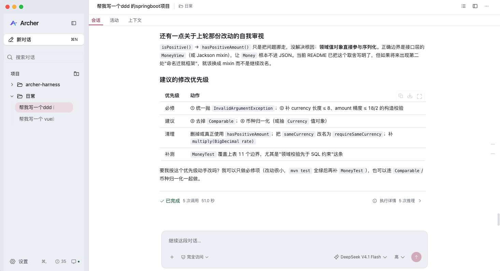
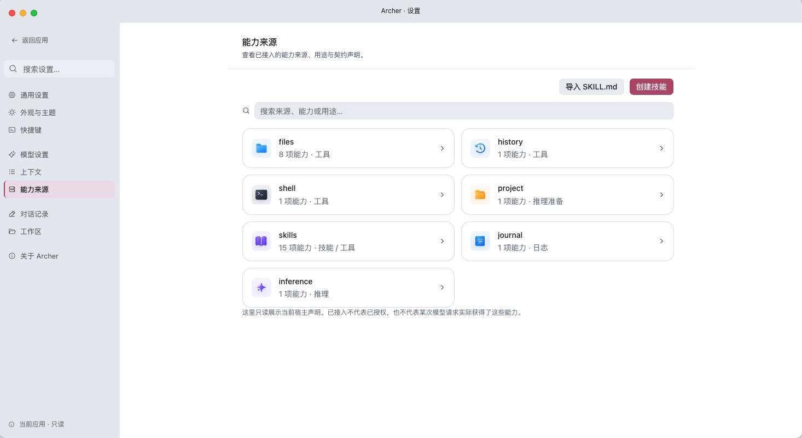
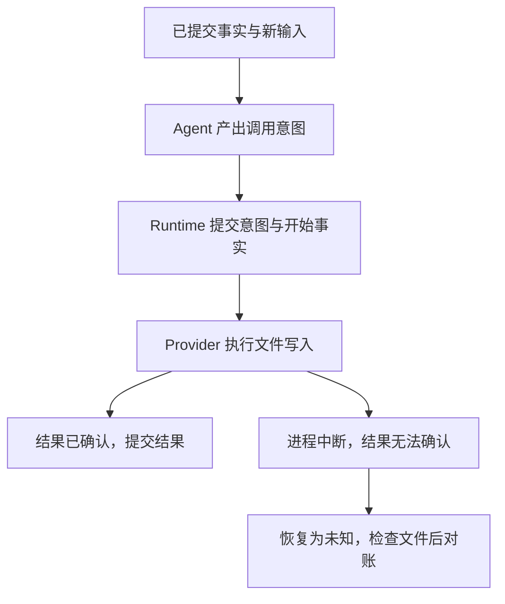
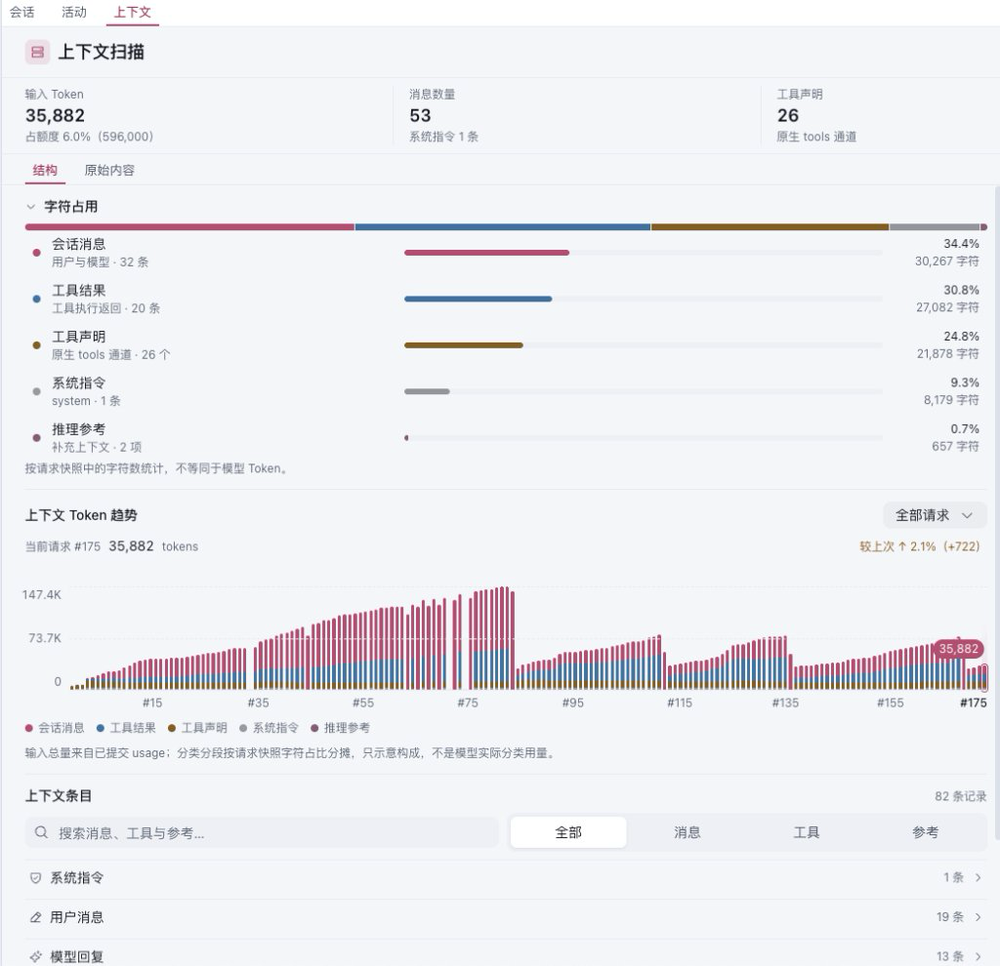

# Archer Harness

Archer Harness 是一个用 TypeScript 编写的实验性 Agent 执行框架，提供桌面应用和 HTTP/SSE 服务。它将 Agent 的控制流、执行策略与外部能力分开，让决策可独立验证，外部操作可追溯，进程重启后能依据已提交事实恢复。

- **最小 Generator 内核。** 当模型调用、工具执行、状态更新和失败处理都写在同一个循环里，调整一条规则容易牵动多个分支。Archer 将这些职责分开，Kernel 只负责交接控制权、结果和异常。
- **固定执行管线与事实恢复。** Runtime 按固定顺序处理人工等待、开始事实、授权和调用。重启后回放 Journal，按已提交事实判断该恢复结果、重新分发还是等待对账。
- **用 Camp 管理类型化能力。** 一个 Provider 可以贡献多个能力。工具、技能、推理和日志各自通过版本化 Contract 声明接口，Camp 统一校验声明、解析能力并管理资源。



桌面端会话展示任务答复与调用摘要，可从「执行详情」继续查看记录。

## Agent Loop 解耦与最小内核

一个 Agent Loop 会反复决定下一步、执行操作，再把结果带入下一轮。Archer 拆开了驱动、决策和执行。Agent 用已提交事实、新输入和显式上下文做纯决策，Effect 表达待执行意图，Runtime 与 Handler 负责授权、调用与提交。Kernel 的 `run` 只在 Generator 与 Handler 之间传递意图、结果和异常。


下面是 Kernel 的完整 `run` 函数。

```ts
export async function run<E, T, R>(
  program: Generator<E, T, R>,
  handler: (effect: E) => R | PromiseLike<R>,
): Promise<T> {
  let step = program.next();
  while (!step.done) {
    let result: R;
    try {
      result = await handler(step.value);
    } catch (error: unknown) {
      step = program.throw(error);
      continue;
    }
    step = program.next(result);
  }
  return step.value;
}
```

这里的 `try` 只包住 Handler 调用。Handler 失败时，Kernel 用 `program.throw(error)` 把异常交回 Generator，由流程决定是否捕获。流程在 `program.next(result)` 中抛出的异常直接向调用方传播。 [Kernel 源码](packages/kernel/src/run.ts) · [异常与清理测试](tests/kernel/run.test.ts)

Runtime 通过 `runCommands` 接入驱动，由执行管线处理授权和提交。Generator 在当前进程内暂停。重启时，Runtime 从 Journal 回放已提交事实，再重建待执行工作。 [Runtime 调用点](packages/runtime/src/archer/session-runtime.ts#L990)

人工等待与执行开始分别在固定的管线位置处理。处理顺序和失败边界可以直接用源码及测试核对。 [固定执行管线导读](showcase/architecture.md#固定管线保护执行顺序)

## Camp、Contract 与 Provider 的能力体系

Contract 声明版本、可序列化元数据和进程内接口。Provider 通过 `offer(contract, metadata, implementation)` 贡献能力，Camp 校验声明、按引用解析实现并管理资源生命周期。调用方通过对应契约使用能力，接入同一契约的新实现通常无需改动 Kernel。 [标准契约与注册实现](packages/camp/src/index.ts#L33) · [公开设计导读](showcase/architecture.md)

| 能力 | 接口 | 用途 |
| --- | --- | --- |
| Tool | `invoke` | 执行文件读写等操作 |
| Skill | `load` | 按需加载技能正文 |
| Inference | `infer` | 发起模型推理 |
| Journal | `ids`、`read`、`append` | 枚举日志、读取事实与提交事件 |

例如，本地技能 Provider 为每个技能声明一个 `Skill.load`，同时提供一个 `Tool.invoke` 读取参考资源。两种能力由同一个 Provider 提供，各自保留调用语义。 [本地技能 Provider 源码](packages/skills/src/index.ts#L90)



桌面端「能力来源」展示宿主已接入的 Provider、能力类型和用途。

模型按 Function Calling 名称发起调用，Runtime 将其绑定到含 Provider ID、能力 ID、Contract ID 和来源 revision 的 `CapabilityRef`。执行和恢复沿用该引用。若需要重新分发而原来源无法解析，调用会进入阻塞状态，避免被交给同名的新实现。 [能力引用与执行边界](showcase/architecture.md#能力引用与执行边界)

Camp 刷新 Provider 时先初始化候选，成功后发布新声明。已有借用继续保护旧实例，释放后才清理。 [刷新与借用导读](showcase/architecture.md#刷新时保持已有调用可用)

## 文件写入中断后的恢复验证

这两个边界在一次文件写入中汇合。Agent 作出调用决策，Runtime 提交意图和开始事实，然后按固定引用调用文件 Provider。执行结果提交后，桌面可据此展示调用活动和文件变更回执。



恢复时，已经提交的结果直接从日志读取。只有开始事实的写入进入「结果未知」，等待检查磁盘后对账。测试模拟了结果尚未追加到日志，以及结果已追加但确认丢失两种情况，并验证重启时不会重写文件。 [文件写入恢复测试](tests/archer/fs-write-recovery.test.ts#L238) · [恢复验证导读](showcase/recovery.md)

执行时更新会话和重启后恢复会话使用同一套事实折叠规则。 [回放一致性验证](showcase/recovery.md#从同一批事实得到同一状态)

## 上下文观测与整理

长会话中，桌面端「上下文」面板可实时查看每次请求的输入结构占比、Token 趋势和条目明细。超过工作区预算时，系统按预设策略自动整理旧工具输出与历史摘要，并将实际执行结果记录到会话事件中，原始事实仍完整保留在日志里。



## 从源码运行

需要 Node.js ≥22.19.0 和 [package.json](package.json) 指定版本的 pnpm。在仓库根目录运行：

```bash
pnpm install --frozen-lockfile
pnpm build
pnpm dev:desktop
```

首次启动没有模型服务：顶部会提示先完成配置，未配置时无法发送任务。在桌面的「设置 → 模型设置」填写服务标识、模型 ID 和 API Key；内置服务的 API 地址可以留空，自定义服务需要填写地址与协议。桌面通过系统加密保存 API Key，并按服务标识和实际请求地址区分。独立 Server 可参考 [模型配置示例](examples/inference.json)，通过 `HARNESS_AI_CONFIG` 指定配置文件的绝对路径，通过 `apiKeyEnv` 引用密钥环境变量。

独立服务可用 `pnpm dev:server` 启动，默认监听 `127.0.0.1:3000`。Shell 和服务访问的使用边界见 [安全说明](SECURITY.md)。

## 开发与验证

```bash
pnpm typecheck
pnpm test
pnpm lint
```

提交问题或改动前请阅读 [贡献指南](CONTRIBUTING.md)。

## 许可证

[MIT](LICENSE)。第三方源码保留各自的来源和许可，见 [第三方组件说明](packages/ui/THIRD_PARTY.md)。
