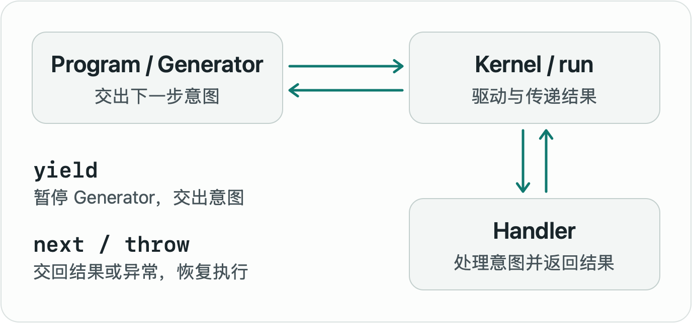
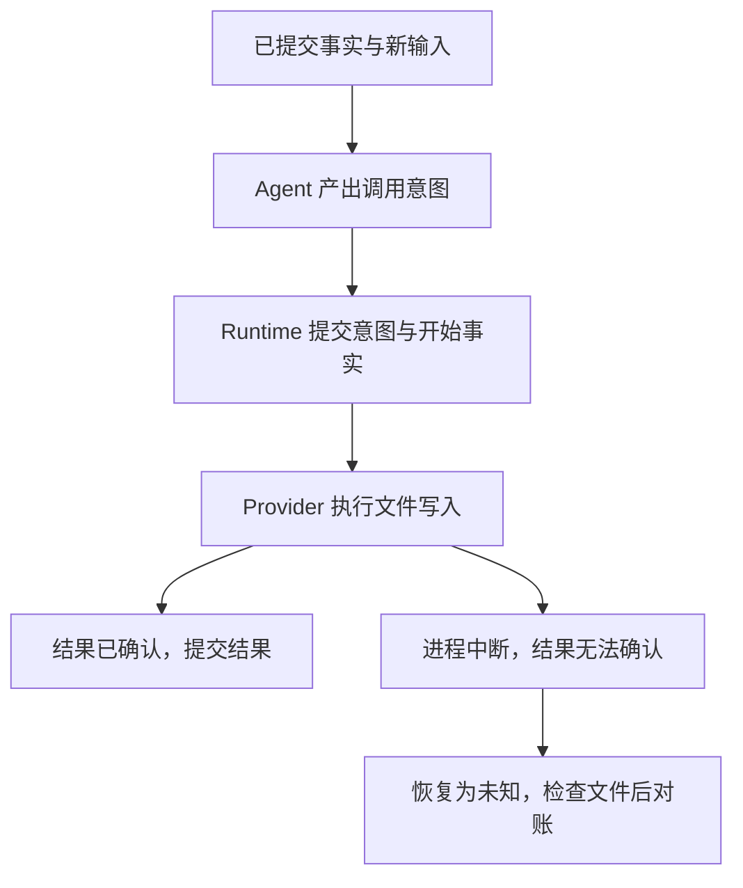

# Archer Harness

Archer Harness 是一个用 TypeScript 编写的实验性 Agent 执行框架，提供桌面应用和 HTTP/SSE 服务。项目围绕两个设计展开。

- **将 Agent Loop 的驱动、决策与执行解耦。** Kernel 只负责 Generator 的控制权交接。Agent 根据事实作出决策，Runtime 提交执行意图、调用能力并记录结果。
- **用 Camp 管理类型化能力。** 一个 Provider 可以贡献多个能力。工具、技能、推理和日志各自通过版本化 Contract 声明接口，Camp 统一校验声明、解析能力并管理资源。


桌面端会话展示任务答复与调用摘要，可从「执行详情」继续查看记录。

## Agent Loop 解耦与最小内核

一个 Agent Loop 会反复决定下一步、执行操作，再把结果带入下一轮。Archer 拆开了驱动、决策和执行。Agent 用已提交事实、新输入和显式上下文做纯决策，Effect 表达待执行意图，Runtime 与 Handler 负责授权、调用与提交。Kernel 的 `run` 只在 Generator 与 Handler 之间传递意图、结果和异常。



下面是 Kernel 的完整 `run` 函数。

```ts
export async function run<E, T, R>(
  program: Generator<E, T, R>,
  handler: (effect: E) => R | PromiseLike<R>,
): Promise<T> {
  let step = program.next();
  while (!step.done) {
    let result: R;
    try {
      result = await handler(step.value);
    } catch (error: unknown) {
      step = program.throw(error);
      continue;
    }
    step = program.next(result);
  }
  return step.value;
}
```

这里的 `try` 只包住 Handler 调用。Handler 失败时，Kernel 用 `program.throw(error)` 把异常交回 Generator，由流程决定是否捕获。流程在 `program.next(result)` 中抛出的异常直接向调用方传播。 [Kernel 源码](packages/kernel/src/run.ts) · [异常与清理测试](tests/kernel/run.test.ts)

Runtime 通过 `runCommands` 接入驱动，由执行管线处理授权和提交。Generator 在当前进程内暂停。重启时，Runtime 从 Journal 回放已提交事实，再重建待执行工作。 [Runtime 调用点](packages/runtime/src/archer/session-runtime.ts#L990)

## Camp、Contract 与 Provider 的能力体系

Contract 声明版本、可序列化元数据和进程内接口。Provider 通过 `offer(contract, metadata, implementation)` 贡献能力，Camp 校验声明、按引用解析实现并管理资源生命周期。调用方通过对应契约使用能力，接入同一契约的新实现通常无需改动 Kernel。 [标准契约与注册实现](packages/camp/src/index.ts#L21) · [能力契约设计](docs/architecture/capability-contracts.md)

| 能力 | 接口 | 用途 |
| --- | --- | --- |
| Tool | `invoke` | 执行文件读写等操作 |
| Skill | `load` | 按需加载技能正文 |
| Inference | `infer` | 发起模型推理 |
| Journal | `ids`、`read`、`append` | 枚举日志、读取事实与提交事件 |

例如，本地技能 Provider 为每个技能声明一个 `Skill.load`，同时提供一个 `Tool.invoke` 读取参考资源。两种能力由同一个 Provider 提供，各自保留调用语义。 [本地技能 Provider 源码](packages/skills/src/index.ts#L90)


桌面端「能力来源」展示宿主已接入的 Provider、能力类型和用途。

模型按 Function Calling 名称发起调用，Runtime 将其绑定到含 Provider ID、能力 ID、Contract ID 和来源 revision 的 `CapabilityRef`。执行和恢复沿用该引用。若需要重新分发而原来源无法解析，调用会进入阻塞状态，避免被交给同名的新实现。 [能力身份与资源生命周期](docs/architecture/capability-contracts.md#固定身份)

## 文件写入中断后的恢复验证

这两个边界在一次文件写入中汇合。Agent 作出调用决策，Runtime 提交意图和开始事实，然后按固定引用调用文件 Provider。执行结果提交后，桌面可据此展示调用活动和文件变更回执。



恢复时，已经提交的结果直接从日志读取。只有开始事实的写入进入「结果未知」，等待检查磁盘后对账。测试模拟了结果尚未追加到日志，以及结果已追加但确认丢失两种情况，并验证重启时不会重写文件。 [文件写入恢复测试](tests/archer/fs-write-recovery.test.ts#L238) · [执行与恢复](docs/architecture/runtime-design.md)

## 当前能力

- 持续会话、多轮输入、后续任务队列与运行中引导。
- 文件读取、编辑与 Shell 命令确认。
- 可配置的模型推理、本地技能包与独立持久记忆 Provider。
- 桌面中的对话、调用活动、请求上下文和工具确认的文件变更审阅。
- JSONL 事实日志、未知操作对账与会话恢复。

## 快速开始

需要 Node.js ≥22.19.0，以及根 `package.json` 指定的 pnpm 版本。当前从源码运行，不提供桌面安装包或已发布的 npm SDK。

```bash
pnpm install --frozen-lockfile
pnpm build
pnpm dev:desktop
```

首次启动默认使用确定性的 Mock 推理，用于验证界面与执行链路，不会调用真实模型。要完成实际任务，请先按[首次运行与模型配置](docs/guides/getting-started.md)配置模型服务，再选择一个存在的绝对工作目录。

独立服务：

```bash
pnpm dev:server
```

默认监听 `127.0.0.1:3000`。模型凭据、会话数据和个人技能不应提交到仓库。Shell 使用宿主权限，不是沙箱；桌面默认逐次询问命令。

## 设计取舍

### 同一会话串行提交，Prompt 编译在锁外完成

同一 Agent 的输入接收、幂等检查、队列消费、决策和提交按顺序进行。编译 Prompt 前，Runtime 在锁内捕获会话版本，再释放锁。编译完成后重新加锁检查版本，取消、停止或版本变化会使旧结果失效。这样，准备 Prompt 期间仍能接收输入和取消请求，同时避免旧 Prompt 推进已经变化的会话。 [Runtime 串行执行与恢复](docs/architecture/runtime-design.md)

### 将上下文整理记录到当次推理

任务固定上下文 Profile 快照。窗口足够时保留历史原文。需要摘要时，摘要只能替换完整的旧助手与工具交互，原始历史仍保存在日志中。实际使用的 Profile 版本和整理步骤随推理结果记录，便于在桌面端检查当时的请求如何形成。普通推理和摘要请求共用用量预算。 [上下文 Profile 设计](docs/decisions/context-profile-engine.md)

## 范围与限制

这是持续演进中的实验项目，当前不承诺持久化格式兼容。升级前请备份数据；不兼容日志会被隔离，不会自动迁移。

- CLI 暂不作为正式使用入口。
- 单进程内每 Agent 最多一个活跃 Turn，每 Turn 最多一个在途 Effect。
- 不提供分布式调度、并行 Effect、子 Agent 或动态代码安装。
- 超时和取消不证明副作用未发生；未知写入不会自动重试，不承诺外部操作 exactly-once。
- 上下文整理保留原始历史，但摘要的语义完整性仍需验证；Token 估算和预算不是费用硬保证。
- 桌面窗口在 macOS 验证，Windows 和 Linux 桌面体验仍需实机验证。

## 文档与开发

- [首次运行与模型配置](docs/guides/getting-started.md)
- [运行、配置、HTTP 路由与接口参考](docs/guides/runtime-usage.md)
- [架构总览](docs/architecture/kernel.md)与[执行和恢复](docs/architecture/runtime-design.md)
- [Provider 与能力契约](docs/architecture/capability-contracts.md)
- [贡献指南](CONTRIBUTING.md)与[安全说明](SECURITY.md)

```bash
pnpm typecheck
pnpm test
pnpm lint
```

GitHub CI 在 Linux 上检查依赖安装、构建、类型、测试与 lint。真实模型和 Electron 窗口需独立验收。 [GitHub Actions](https://github.com/ypconfig-17/archer-harness/actions/workflows/ci.yml)

## 许可证

[MIT](LICENSE)。复制到仓库的第三方源码保留各自的来源与许可，见[组件对照样板说明](apps/desktop/renderer/src/ui/ai-ui/playground/reference/README.md)。
