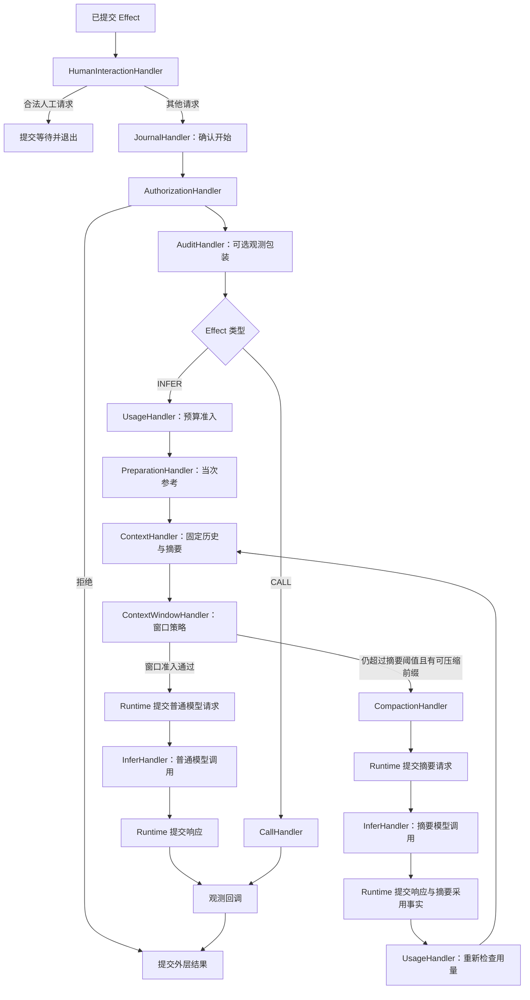

# Handler 职责、算法与执行边界

`@archer/handler` 集中解释执行意图，并管理本次推理的上下文、窗口和用量。Runtime 提供固定能力、显式事实快照和唯一提交端口；Agent 只折叠事实、解释模型输出并产生后续意图。Kernel 只交接 Generator 控制权。

本文中的 Handler 表示一个执行职责。公共包装使用 EffectMiddleware，推理内部阶段使用显式函数调用。不是每个阶段都需要包成中间件，也没有可重排的插件注册链。

## 调用顺序

项目参考在一次 INFER 中只准备一次，摘要后的上下文重建复用该次参考。每次实际模型调用都重新检查累计用量和完整输入窗口。图中的回路最多执行 4 次摘要；摘要请求不递归进入项目准备或普通上下文链。所有失败都按所属边界返回或传播，图中省略错误连线。

## 1. HumanInteractionHandler

**入口：** `human-interaction.ts / withHumanInteraction`。

**负责：** 将 ASK_HUMAN 和合法的人工 CALL 转为持久化等待，不执行 Provider，也不伪造完成结果。

**核心算法：** 先识别交互声明；人工 CALL 还需检查固定目标、交互元数据与输入 Schema。合法请求调用宿主 suspend，返回 null；无效请求透传给授权层形成确定拒绝。Shell 的逐命令审批仍由 Runtime 在开始前完成，这个 Handler 不复制审批调度。

**好处：** 重启能恢复等待；人工回复与能力调用保持不同语义；未批准的操作不会通过伪造返回值继续。

## 2. JournalHandler

**入口：** `journal.ts / withJournal`。

**负责：** 包围一次外层 Effect 的开始和收束，不直接打开日志文件。

**核心算法：** `begin → next → complete`。begin 返回 false 时不执行；内部返回 null 时不提交完成；提交异常直接传播。串行锁、expectedSeq、原子批次和隔离由 Runtime 的 ExecutionJournal 端口实现。

真实模型请求还有更细的提交边界：Runtime 先提交 inference.requested，再调用模型，再提交 inference.responded 或 inference.request.failed。摘要采用额外提交 context.compacted。它们属于同一个串行 INFER 的执行事实，不产生并行 Effect。

**好处：** 先提交后执行，开始或结果确认未知时及时隔离；同时保留准备后实际输入，避免原始意图和模型真实请求不一致。

## 3. AuthorizationHandler

**入口：** `authorization.ts / withAuthorization`。

**负责：** 验证固定 CALL 目标、交互声明、Shell 单 Turn 授权和输入结构。

**核心算法：** 按固定顺序检查 targetError、目标存在性、interaction 一致性、allowShell 和 JSON Schema，首次拒绝即返回 failed。INFER 透传。Runtime 在此之前按 CapabilityRef 解析原实现，并在开始提交前重新验证 executionRevision。

**好处：** 不能按名称偷偷选择新实现；拒绝作为已提交结果保留；Provider 不接管权限决策。Shell 仍使用宿主权限，审批不是操作系统隔离。

## 4. AuditHandler

**入口：** `audit.ts / withAudit`。

**负责：** 观察内部执行状态和耗时，不影响执行结果。

**核心算法：** 显式时钟记录进入和退出时间，调用只读观测回调；回调异常被隔离。授权拒绝发生在它外层，不进入观测回调。

**好处：** 遥测故障不破坏任务。回调在外层结果提交前运行，不能当作已提交事件通知；正式订阅仍由 Runtime 在提交确认后推送。

## 5. ContextHandler

**入口：** `context.ts / buildContext`。

**负责：** 从 INFER 固定的完整历史快照和已提交摘要构建模型视图，不自行读取最新会话。

**核心算法：**

1. 按 promptPrefixCount 分开固定前缀与历史。
2. 有有效摘要时，插入明确标记为非可信参考的摘要；覆盖范围内保留所有用户和系统消息，整组替换较早助手与工具交互。
3. 未采用摘要的历史原文全部保留，不按工具年龄或共享字符额度主动截断。保留消息的参数、身份、签名和配对不变。
4. contextProjection 记录原始与投影字符量、由摘要替换的消息数量，不把字符量当 token。

原始消息不删除，不生成虚假的 artifact 读取地址，也不允许通过重复写命令取回结果。

**好处：** 窗口充足时避免提前丢失代码证据；用户约束保持原文，同样快照产生同样视图。字符统计不是完整请求上限。

## 6. PreparationHandler

**入口：** `inference-preparation.ts / prepareInference`。

**负责：** 执行 Archer 显式选择且固定到 INFER 的准备引用，生成当次项目参考。

**核心算法：** 按固定顺序调用 prepare；每项 JSON 序列化 UTF-8 最多 64 KiB，合计最多 256 KiB；将结果包装成非可信 user 参考，插在上下文前缀后、保留历史前。循环前后检查取消。每次 INFER 重新观察，摘要请求不重复运行准备能力。

**好处：** 项目参考有来源、有大小边界，不污染长期历史或可信系统规则；不会自动扫描或执行工作区代码。参考进入实际请求消息，普通推理结果还保留结构化 preparations。

## 7. ContextWindowHandler

**入口：** `context-window.ts / measureWindow、assertWindow`、`context-policy.ts / conditionMatches、selectContextStep、recentTargetTokens、measureUncoveredHistory`，由内部固定流程 `context-management.ts / manageContext` 驱动。

**负责：** 完整输入估算、输出预留、声明式策略链的触发判断和最终窗口准入。策略函数是纯计算：只读取本地测量快照、未覆盖历史估算和 Profile，不调用 Provider、不提交事实、不访问时钟。未覆盖历史估算用“前缀 + 未覆盖历史”与“仅前缀”两次本地计量之差得到。

**核心算法：**

- 调用固定 Inference 的可选 measure，取得 contextWindow、maxOutputTokens、estimatedInputTokens 和估算方法；验证返回值。
- 输出预留 O 优先采用 config.maxTokens，缺省按模型输出上限保守预留。普通请求配置保持原样，不为预留改成 4096；超出模型输出上限明确拒绝。
- 安全余量 S = max(256, ceil(W × 2%))；完整输入额度 B = max(0, W - O - S)。
- 每个 INFER 以已提交的 `config.contextProfile` 作为策略链；缺少快照明确返回 `CONTEXT_PROFILE_REQUIRED`，执行时不补默认值。策略链最多执行 16 轮评估：
  - 依次检查启用步骤：可选 `when` 条件（指标比较，支持 ANY/ALL 递归嵌套）全部成立后，再判断步骤自身的触发线。
  - 摘要步骤：容量预留 G = min(reserveTokens, floor(B × 15%))，容量触发线 T = B - G；完整输入超过 T 记为 `capacity`，未覆盖历史超过 growthTokens 记为 `growth`。近期目标 K = min(keepRecentTokens, floor(B × 25%))。
  - 工具结果节选步骤：完整输入超过 B 的 85% 时记为 `capacity`，超过 B 时记为 `overflow`；步骤条件仍作为附加过滤。
  - 第一个命中的步骤执行一次；摘要无法规划、校验失败或没有收益，以及节选未达收益门槛时，只阻塞当前输入上的该步骤并尝试后续步骤。采用整理结果后清空阻塞集合并重新评估。每个 INFER 最多提交 4 次摘要请求，失败及未确认请求也计入上限，恢复不重置额度；达到上限不再新增摘要请求，已确认响应仍可采用，后续节选仍可执行。
- 条件里的指标缺失（例如模型不提供未覆盖历史计量）时比较不成立；`inputRatio` 在零额度窗口上同样不可判定。条件本身不触发整理，只做过滤，避免页面配置悄悄扩大执行范围。
- 每次真实请求前再次检查窗口，仍超限明确拒绝。

这些阈值是待质量评测的工程基线，不是论文证明的最优值。Pi 适配器基于转换后的完整上下文按字符类别折算 token，附加消息封装余量；它不是服务端精确 tokenizer，可能过度预留或仍被模型服务拒绝。容量线与增长线使用同一估算口径比较，增长线不要求绝对值精确。

**整理记录：** 实际采用的普通推理结果在同一提交中写入 `contextPlan`（profileId、profileName、profileRevision、beforeTokens、afterTokens、inputLimit、命中的步骤与原因）。界面只展示已提交记录，不按页面当前配置推测历史任务的执行情况。

**好处：** 用户输入、工具 Schema 与准备参考都纳入检查；默认保留精确信息，输入额度与实际生成配置不再混淆。策略调整通过声明式 Profile 完成，执行、条件求值和窗口安全边界不需要改 Handler。

**边界：** 未实现 measure 的 Provider 保留完整历史，不触发窗口检查或自动摘要，不虚构窗口和 token 数。原始工具生成单次结果时的明确大小限制不由历史处理替代。Profile 只声明顺序、参数与条件，页面无法关闭窗口准入、摘要校验或完整批次保留。

## 8. CompactionHandler

**入口：** `compaction.ts / planCompaction、validateCompaction`，由 `context-management.ts` 调用。

**负责：** 选择历史分段、生成受控摘要、验证输出并请求 Runtime 提交采用事实。

**核心算法：**

1. 以已采用摘要的 coveredMessageCount 为起点，在合法批次边界测量尾部 token，二分寻找仍达到近期目标 K 的最晚边界；用户原文无论是否位于覆盖内都保留。
2. 扫描工具调用 ID 集合，仅在没有未配对调用的边界截取前缀。没有可替换助手或工具交互时不摘要。
3. 构造“上次结构化交接 + sourceStart + 本段原始消息”的摘要请求；输入放在非可信数据中，不携带工具声明或项目准备引用。
4. 摘要生成上限取 min(预算, 模型输出上限, max(1, floor(W × 10%)))，预算来自步骤参数 `summaryBudgetTokens`：0 表示自动使用 16,384，固定值范围为 1,024–65,536。该上限同时覆盖思考与正文：推理模型的思考 token 计入同一输出预算，上限过小会出现思考写满、正文为空且 stopReason=length 的响应。步骤可选 `reasoning` 指定摘要推理等级，缺省沿用任务等级；摘要请求不携带 `contextProfile`，避免嵌套整理。在近期保护允许的安全边界中，二分寻找摘要窗口可容纳的最大分段；最小合法段也无法容纳则停止。两次边界搜索依赖固定模型下追加完整消息不会减少输入估算的计量约定。
5. 通过 Runtime 的 executeInference 提交摘要请求并执行 InferHandler。摘要的临时文本不推送为普通答复进度。
6. 拒绝空摘要、超过 16,384 字符的摘要、截断输出和工具计划；按 ContextHandoffSchema 校验六组交接内容，发现、失败方案及决策必须带原始消息索引和原文引文，声明的工具结果分类须与源消息一致。成功用量仍保留，不因验证失败抹掉消耗。
7. 采用前先重建候选完整请求，确认计量方法、输入额度、输出预留和安全余量一致，且估算输入严格减少。失去计量能力或口径改变时明确返回 CONTEXT_MEASUREMENT_CHANGED，不采用候选。无效或无收益的候选不采用，继续尝试策略链中的后续步骤；最终仍超窗且没有可用补救时保留具体摘要失败原因，否则继续可容纳的原文或节选。提交异常与计量变化不进入该回退。已产生用量仍保留，继续原文前也重新检查预算。Runtime 确认 context.compacted 后才使用候选；重放校验源分段、输出与工具边界。

每个 INFER 最多提交 4 次摘要请求（包括失败、未确认、无效和无收益请求），额度从事实恢复，防止无限摘要。不可拆交互不会截成孤立工具结果；原文超限且摘要无法处理时明确拒绝。交接提示要求发现、假设、排除方案、决策前提、阻塞、下一步与来源；当前校验不证明这些内容的语义正确。

**好处：** 摘要有来源、成本和覆盖边界；已确认摘要可跨 Turn 与重启复用；不会把摘要当作执行成功证明。用户消息一直保留，因而大量用户输入仍可能最终超窗。

## 9. UsageHandler

**入口：** `usage.ts / usageAdmission`，实际用量由 InferResultSchema 校验。

**负责：** 根据当前 Turn 的已提交真实请求执行累计预算准入，普通推理和摘要使用同一本账。

**核心算法：** 每次真实模型请求前累加各 requestId 的 `promptTokens + completionTokens`。缓存读写是输入子集，不再相加。达到预算返回 TOKEN_BUDGET_EXCEEDED；任一已发请求缺少实际用量、失败或仍未确认时，显式预算返回 TOKEN_USAGE_UNAVAILABLE。刚提交的摘要响应加入本次工作快照，再判断能否请求普通模型。

外层 effect.completed 复用普通响应，不重复累计。已取得的最终答复仍允许完成，已计划工具不因预算检查被撤销。预算是后续请求准入，不提供单次调用或费用硬上限；没有价格数据时不推测费用。

**好处：** 摘要不成为隐藏消耗；恢复不重置预算；未知请求不被错误当作免费。桌面端从实际请求事实累计用量，避免双算与漏算摘要。

## 10. InferHandler

**入口：** `infer.ts / infer`。

**负责：** 调用已固定的 Inference.infer，校验并返回模型结果。

**核心算法：** 接收已准备请求和 AbortSignal，调用一次 Provider，使用 InferResultSchema 验证正文、工具意图、停止原因和可选用量。它不知道摘要覆盖算法、会话存储或预算累计，不自行重试。

Runtime 在调用前确认实际请求，在返回后确认响应；响应提交确认丢失时隔离。已提交普通响应但外层 INFER 尚未收束时，恢复直接复用响应。摘要响应提交但采用事实尚未提交时，复用相同分段请求的确认响应，再提交采用事实。

**好处：** 同一模型执行端口服务两种用途，避免递归管线或未记账的模型网关；成功响应不会因外层提交中断而被重复请求。

## 11. CallHandler

**入口：** `call.ts / call`，结果归类共用 `outcome.ts`。

**负责：** 执行已解析的 Tool.invoke 或 Runtime 适配后的 Skill.load，校验 JSON 结果并区分确定失败与副作用未知。

**核心算法：** 复制输入；read 执行只获得受控只读写端口；调用一次能力。校验 JSON 和显式 resultView，只有 output 声明才投影正文，显式 isError 可表示已完成操作的业务失败。read 异常或 OperationRejected 记 failed；write/shell 调用后的异常与非法返回记 unknown。停止时不确定的执行返回 null，交给恢复。

**好处：** 不把超时、取消或断连误当作未写入；不猜测第三方结果字段；文件写入和命令不会因取回输出被隐式重复。

## 事实与恢复边界

持久化事实顺序为：外层 effect.created → effect.started → inference.requested → inference.responded；摘要校验通过后追加 context.compacted，再安排下一请求；最后外层 effect.completed 与 Agent 后续决定一起提交。

请求异常使用 inference.request.failed，异常不证明零消耗。停止留下的 requested 表示没有确认响应，外层恢复机制决定是否许可重试；有显式 tokenBudget 时未知用量会阻止新请求。已完成副作用仍不重放。

摘要是模型上下文参考，不是日志 checkpoint，不缩短全量回放，也不恢复 Generator、锁或连接。独立 COMPACT Effect 仍未支持，不能从协议中的占位类型推断执行能力。

设计取舍见 [上下文执行事实边界](../decisions/context-execution-facts.md)。

## 管理界面的上下文默认值

设置中的“上下文管理”保存当前设备的 Profile 选择与任务预算。完整 Profile 写入 `inference.contextProfile`，累计预算写入 `limits.tokenBudget`；两者共用 `@archer/contracts` 的 Zod Schema，页面只编辑声明式配置。发送和加入队列时深拷贝解析后的 Profile；未知提交重试复用原快照，任务内后续 INFER 沿用首个已提交 INFER 的 Profile，即使页面随后修改也不影响进行中的任务。Runtime 按既有接受事实和 INFER 事实恢复，无新增配置存储或执行端口。

CLI／SDK 未提供任务 Profile 时，继承会话创建事实中的完整默认快照：创建时的显式策略优先，否则写入内置均衡模板。后续推理和恢复不重新读取代码默认值；内部继承不改写用户原始提交的幂等签名。

Profile 结构为 `version: 1`、`id`、`name`、`description`、`revision` 与 1–8 个有序步骤。每个步骤声明 `kind`（`compact` 或 `trim-tool-results`）、稳定 `id`、`enabled`、可选 `when` 条件和自己的参数：

- 摘要步骤：`reserveTokens` 为 0–1,000,000；`growthTokens` 为 1–1,000,000；`keepRecentTokens` 为 1–1,000,000；`summaryBudgetTokens` 为 0（自动）或 1,024–65,536；可选 `reasoning`。
- 节选步骤：`minSavingsRatio` 为 0.05–0.75，按整理前完整估算输入计算最小节省比例；多条结果可共同达标，未达标整批保留原文。单条工具正文保留额度为 min(4096, floor(输入额度 × 25%)) 个估算 token，并受剩余窗口限制。
- `when` 条件读取 `inputRatio`、`estimatedInputTokens`、`uncoveredTokens` 与 `historyMessages`，支持 `gte/gt/lte/lt` 比较和最多 4 层 ANY/ALL 嵌套（每组最多 8 项，单个步骤最多 24 个比较）。

内置模板“上下文质量优先”“均衡模式”“Token 优化优先”为只读常量，界面修改时自动创建自定义副本；保存自定义 Profile 时 `revision` 递增，界面和 `contextPlan` 据此识别实际使用的版本。完整 Schema 校验覆盖参数范围、步骤标识唯一、最多启用一个节选步骤、嵌套深度与比较数量；页面、HTTP／SDK 和事实解析复用相同规则，条件深度在结构解析时受限，不只在页面保存前检查。

预算留空表示不设置任务累计上限；普通模型调用和摘要共用已提交用量。预算限制后续请求准入，单次调用可能超出剩余额度，不提供费用硬保证。模型端口可以动态返回无计量能力，此时不伪造窗口估算；服务端模型配置代理保留 `measure`，切换到支持计量的模型后可执行窗口检查。

## 算法质量边界

容量合法、工具配对完整、收益为正均为工程条件，不能证明摘要保留了业务语义。增长线按估算体积触发，阈值只控制整理频率与单次摘要源规模，不证明被摘要内容的业务价值。当前交接经过结构与原文引用校验，但仍依赖模型选择内容；不能机械证明结论成立或失败方案、先决条件没有遗漏。每个 INFER 最多四次摘要是执行上界，不保证一定能把任意历史整理到窗口内。

pi 的后备估算按适配后上下文的字符类别折算（ASCII 4 字符/token，非 ASCII 1 字符/token），并附加消息开销；这不是 tokenizer 计数，也不是服务端窗口的数学上界。中文为主的真实会话样例中估算/实际约为 1.0–1.1；该比值依赖文本构成，不能外推为其他语言或模型的固定系数。默认输出预留采用模型输出上限，会压缩可用输入额度。阈值、近期体积和单纯正收益门槛是保守基线，尚无成对续跑任务成功率数据支持最优性。预算限制后续调用准入，不能避免某一次请求超出剩余预算。

结构化交接与只读原证据恢复提供机械保护；损害与挽救任务比例、计量误差和摘要额外开销仍需独立实验，不能用单元测试通过代替。

## 事实参考与证据恢复

使用已提交摘要时，ContextHandler 同时投影 Runtime 提供的 CALL 事实快照，区分执行收束、业务失败、失败、取消、未知和待执行。放弃追踪不改变未知结果；文件回执只记录明确路径和 revision，命令退出码只取结构化记录。最多 32 条、记录 JSON 合计最多 8192 字符，优先保留未确认事项；无法容纳全部未确认事项时停止，收束记录遗漏数量明确给出。参考作为数据加入实际请求并参与计量。

`history.read` 是显式装配的普通工具，CALL 管线传入当前 Agent 的 HistoryReader，只读已提交模型正文。按 callId 和可选 turnId 查询，默认分页 4096、最多 8192 个 UTF-16 字符，不拆代理对、不重跑旧工具、不返回隐藏结果元数据、不跨 Agent。SDK 宿主通过 historyProvider() 选择装配；CLI 与 Server 已显式装配。

交接结构、事实参考、恢复校验和历史读取的具体边界见 [摘要与证据决策](../decisions/context-evidence-boundary.md)。这些能力保护可追溯性与可恢复性，不替代任务成功率评测。

## 交接的范围、行动和无结果

当前 ContextHandoffSchema 只接受 version: 2。工具引用分类为 completed / tool-error，不能将消息的 isError 简化成业务失败；执行事实参考继续分别表达 business-error、failed 和 unknown。

nextActions 必须为包含 action、preconditions 和 rereadEvidence 的对象。重读证据与发现、决策的引文共用来源校验；不允许以字符串行动省略前提字段。摘要旁标注覆盖范围 [0, coveredMessageCount)，只代表该历史范围内有来源支持的解释，不宣称全局最新状态。后续原文保持完整，可以更新或推翻旧结论。

没有可用内容时可返回 version: 2、kind: no-handoff、reason: no-useful-information / insufficient-evidence。CompactionHandler 将其归为 CONTEXT_COMPACTION_UNAVAILABLE，不构造替换历史的候选；原文能容纳则继续原文，超限则停止。它仍消耗实际用量，既不作为免费重试，也不能提交 context.compacted。

handoffReport 是已提交请求的纯诊断投影，统计引用开销、采用情况和已报告用量，不参与执行准入、不增加提交事实，也不评价语义正确性。详见 [证据边界](../decisions/context-evidence-boundary.md)。

## 请求预算与计量诊断

摘要触发和规划计量使用当次 prepared 请求的配置、工具声明和固定参考前缀，包含项目参考、已有交接和执行事实参考。增长触发量改为计量原始 INFER 中摘要覆盖范围之后的原始历史，与请求投影分开计算：已采用的摘要不会重复计入增长，投影带来的参考开销也不冒充新工作集。规划的尾部投影保留覆盖范围内的用户及系统原文，但这些固定保留内容不计入近期助手和工具体积；参考前缀占用先从可用输入额度中扣除，再限制近期保护目标。摘要源仍取原始历史，索引不随请求投影改变。摘要采用后的完整候选重新计量，最终请求准入不依赖估算压缩率。

超过输入额度 85% 且策略选中节选步骤时，tool-result-window 对可从已提交历史重读的超大工具正文生成明确节选；低于容量线不节选，原始事实保持完整。具体条件与信息损失取舍见 [证据边界](../decisions/context-evidence-boundary.md)。

handoffReport 的 measurements 同时覆盖普通推理和摘要请求，按请求输出固定能力引用、配置、计量方法、estimatedInputTokens、实际 promptTokens 及 estimateToActualRatio。比值为估算除以实际输入；实际输入为零时比值为 null，缺少用量时不补零。缓存明细不重复加到 promptTokens。报告只使用已提交结果，不在线学习或调整准入系数；不同来源、模型和方法不自动合并，字符类别计量是经验口径，不是服务端上界。

工具结果节选采用 85% 容量线与 4096 个估算 token 的单条保留上限，避免接近窗口时反复传输大结果。仍需满足 Profile 条件和完整输入收益门槛；不会自动启用关闭的步骤。仅改变当次模型请求投影，Journal 原文、摘要覆盖与恢复事实不变。验证命令：`pnpm exec vitest run tests/handler/context-policy.test.ts tests/handler/tool-result-window.test.ts tests/handler/context-window.test.ts`，覆盖提前节选、低占用原文、来源与配对、收益及超窗拒绝。
